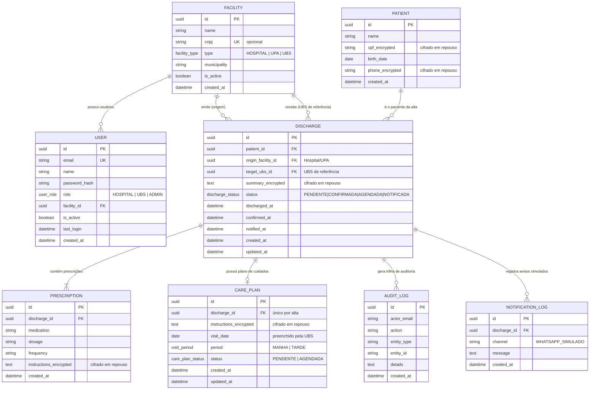
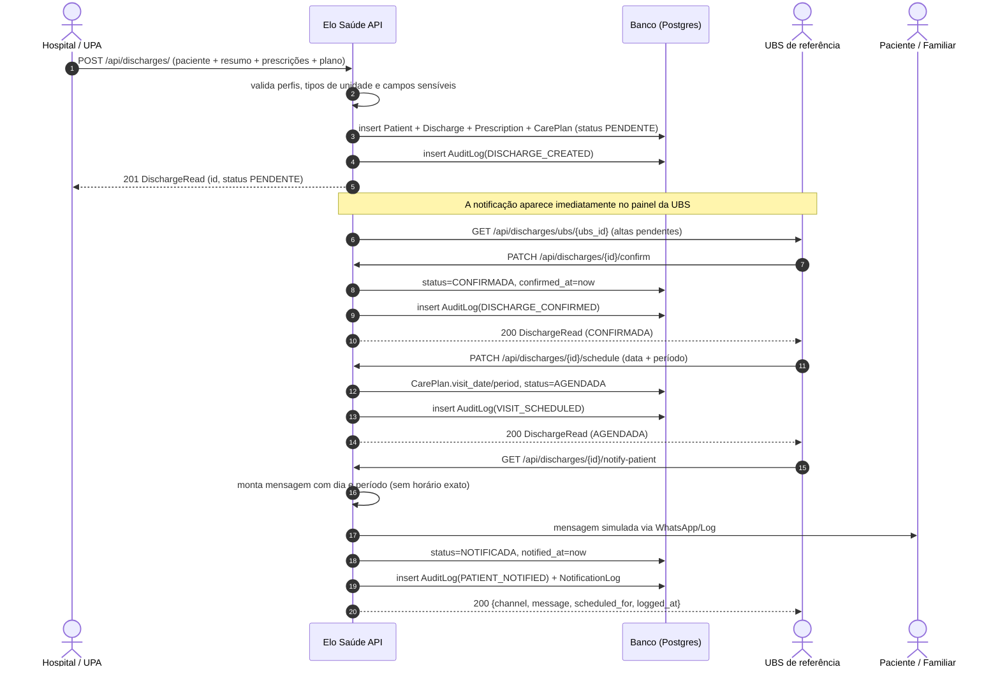

# Elo Saúde — Arquitetura do MVP

> **Desafio:** Challenge CIS-AMFRI 2026 · Desafio 03 — *Fluidez, transparência e integração regional na contrarreferência em saúde.*
>
> **Objetivo do MVP:** garantir que a alta hospitalar gere uma contrarreferência rastreável, com notificação à UBS, confirmação de recebimento, agendamento da visita domiciliar e aviso simulado ao paciente.

---

## 1. Arquitetura escolhida

Adotamos **Clean Architecture adaptada a um monólito modular em camadas**. Para um MVP acadêmico/regional, um único serviço FastAPI com fronteiras internas bem definidas entrega mais valor do que microservices: menos custo operacional, transações locais simples e facilidade de demonstração.

```
Interfaces (HTTP/API + HTML/Jinja2)
        ↓
Application (casos de uso, schemas Pydantic, regras de transição)
        ↓
Domain (entidades SQLAlchemy, enums, invariantes)
        ↓
Infrastructure (SQLAlchemy, Alembic, criptografia, JWT, .env)
```

**Regra de dependência:** as camadas externas dependem das internas; o domínio não conhece FastAPI, HTTP nem banco de dados. Os routers são finos — validam entrada, chamam o serviço e retornam o schema.

### Decisões técnicas

| Decisão | Justificativa |
|---|---|
| FastAPI + Pydantic v2 | Validação declarativa, documentação OpenAPI automática e tipagem forte. |
| SQLAlchemy 2.x (ORM, `DeclarativeBase`) | Portabilidade entre PostgreSQL (produção) e SQLite (testes). |
| Alembic | Histórico de schema versionado e aplicável em produção. |
| PostgreSQL em produção / SQLite em memória nos testes | Fidelidade de tipos em produção e testes rápidos e isolados. |
| Jinja2 server-side | Telas simples, sem build frontend, adequadas ao MVP e à demonstração. |
| JWT (`HttpOnly cookie` no HTML, `Bearer` na API) | Login com perfis (`HOSPITAL`, `UBS`, `ADMIN`) e menor exposição de token no navegador. |
| Argon2id (pwdlib) para senhas | Hash com salt e custo ajustável; nunca armazenamos senha em texto. |
| Fernet (AES-128-CBC + HMAC) para campos sensíveis | CPF, telefone, resumo clínico e instruções cifrados em repouso. |
| AuditLog | Rastreabilidade de quem criou, confirmou, agendou e notificou cada alta. |
| Dados sintéticos | Nenhum dado real de paciente é usado no MVP (LGPD, princípio da necessidade). |

> **Importante:** a notificação ao paciente é **simulada**. O endpoint `GET /api/discharges/{id}/notify-patient` apenas monta a mensagem, registra em log/auditoria e a devolve em JSON — nenhum WhatsApp real é enviado.

---

## 2. Diagrama de Entidade-Relacionamento (ERD)



### Máquina de estados da contrarreferência

```
PENDENTE ──confirmar──▶ CONFIRMADA ──agendar──▶ AGENDADA ──notificar──▶ NOTIFICADA
```

Transições inválidas (por exemplo, agendar antes de confirmar) retornam **HTTP 409 Conflict** e não alteram o estado — transparência e previsibilidade para as equipes.

---

## 3. Diagrama de sequência — fluxo completo



---

## 4. Estrutura de diretórios

```text
Challenge-CIS-AMFRI/
├── .env.example                 # modelo de variáveis (sem segredos reais)
├── .env                         # configuração local simulada (não versionar)
├── requirements.txt             # dependências do MVP
├── pyproject.toml               # metadados + tasks (poetry/taskipy)
├── alembic.ini
├── alembic/
│   ├── env.py                   # integração Alembic ↔ settings.SQLALCHEMY URL
│   └── versions/
│       └── 0001_initial.py      # migração inicial (exemplo gerado)
├── docs/
│   └── ARQUITETURA.md           # este documento
├── src/
│   ├── challenge/
│   │   ├── __init__.py
│   │   ├── app.py               # factory FastAPI, lifespan, CORS, exception handler
│   │   ├── settings.py          # pydantic-settings (.env)
│   │   ├── database.py          # engine, SessionLocal, get_session
│   │   ├── models.py            # entidades SQLAlchemy 2.x
│   │   ├── enums.py             # enums de domínio
│   │   ├── schemas.py           # Pydantic v2 (Create / Read / Update)
│   │   ├── crypto.py            # Fernet + TypeDecorator para campos cifrados
│   │   ├── security.py          # hash Argon2id, JWT, RBAC
│   │   ├── exceptions.py        # DomainError → HTTP
│   │   ├── services.py          # regras de negócio (casos de uso)
│   │   ├── seed.py              # unidades e usuários de demonstração
│   │   ├── routers/
│   │   │   ├── __init__.py
│   │   │   ├── auth.py          # POST /api/auth/login
│   │   │   ├── discharges.py    # endpoints da contrarreferência
│   │   │   └── web.py           # telas Jinja2 (Hospital, UBS, Paciente)
│   │   └── templates/
│   │       ├── base.html
│   │       ├── login.html
│   │       ├── hospital.html
│   │       ├── ubs.html
│   │       └── paciente.html
│   └── routers/                 # scaffold vazio preservado do projeto original
└── tests/
    ├── __init__.py
    ├── conftest.py              # SQLite in-memory + TestClient + seed
    └── test_discharges.py       # criação, listagem e fluxo completo
```

---

## 5. Segurança, privacidade e LGPD (MVP)

| Risco | Medida adotada |
|---|---|
| Vazamento de credenciais | Senhas com Argon2id; segredos apenas em `.env` (ignorado pelo Git); `.env.example` sem valores reais. |
| Roubo de sessão | JWT com expiração; cookie `HttpOnly` + `SameSite=Lax` nas telas; `Bearer` na API. |
| Escopo indevido | RBAC: só `HOSPITAL` cria altas; só `UBS` confirma e agenda. |
| Exposição de dados sensíveis | CPF/telefone/resumo/instruções cifrados em repouso; CPF e telefone mascarados nas respostas de leitura. |
| Injeção SQL | Uso exclusivo de ORM/SQLAlchemy com parâmetros vinculados. |
| Falta de rastreabilidade | `AuditLog` em todas as transições + `NotificationLog` do aviso simulado. |
| Uso de dados reais | Seed e testes usam apenas dados fictícios (CPF válido, porém sintético). |
| Transporte | Exigir HTTPS/TLS na proxy reversa em produção; `COOKIE_SECURE=true` fora de desenvolvimento. |

**Limitações deliberadas do MVP:** não há recuperação de senha, refresh token, revogação de token, integração real com E-SUS/RNDS/FHIR nem envio real de WhatsApp. Esses pontos ficam como evolução natural para a versão 2.
